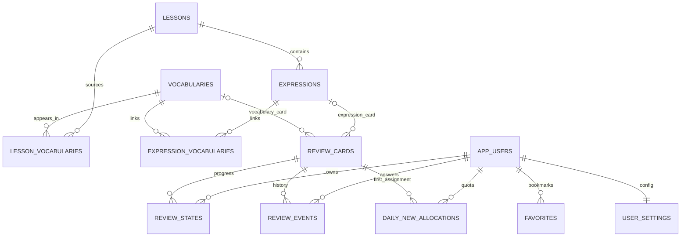

# 数据库设计 v1

状态：Prisma 模型、初始迁移与完整性约束已创建并应用。实际模型见 apps/api/prisma/schema.prisma。PostgreSQL独立数据库jp_study；不共用菜谱业务表或凭据。

## 实体

| 表 | 主要字段 | 约束/说明 |
|---|---|---|
| app_users | id UUID PK、created_at | 第一版固定个人用户，预留未来归属但不做注册 |
| user_settings | user_id PK/FK、daily_new_limit默认10、timezone | limit 0–100，timezone本版Asia/Tokyo |
| lessons | id text PK、title、lesson_date date nullable、created_date date、tags jsonb、source_files jsonb、memo_markdown text、content_version text、imported_at | 源lesson_ID，content_version为规范化内容hash |
| expressions | id text PK、lesson_id FK、japanese、meaning_zh、original_japanese nullable、error_example_japanese nullable、corrected_japanese nullable、explanation_zh、contexts/examples/tags jsonb、origin、verification、active | 稳定expr_ID，修订不重建 |
| vocabularies | id text PK、japanese、reading、part_of_speech、meaning_zh、active | 稳定vocab_ID，词义身份冲突禁止覆盖 |
| lesson_vocabularies | lesson_id + vocabulary_id联合PK/FK、collocations/examples/tags jsonb、origin、verification、active | 保留每课来源，公开词库聚合 |
| expression_vocabularies | expression_id + vocabulary_id联合PK/FK | JSON的关联，拒绝不存在词条 |
| review_cards | id UUID PK、item_type、expression_id?、vocabulary_id?、card_type、active、created_at | 唯一条目＋卡型；两个item FK恰好一个非空并与type一致 |
| favorites | user_id + item_type + item_id联合唯一、expression_id?、vocabulary_id?、created_at | 同样有具体FK及二选一约束，避免悬空多态引用 |
| review_states | user_id + card_id联合PK/FK、stage、last_rating nullable、last_reviewed_at nullable、next_due_at nullable、version默认0 | stage 0–4，新增未学next_due为空 |
| review_events | event_id UUID PK、sequence bigserial唯一、user_id/card_id FK、rating、answered_at、received_at、device_id UUID、algorithm_version、payload_hash、result_state jsonb | event_id重试去重；原始payload不同报冲突 |
| daily_new_allocations | user_id + card_id联合PK/FK、allocated_date date、allocated_at | 卡首次分配唯一；索引user/date保障每日配额统计 |

Review queue可以返回临时queue_id供客户端标识，不要求V1建服务器会话表。客户端保存队列与当前位置；真正永久记录是review events/state和新卡分配。

## 关系图

## 字段与索引

所有实例时间用timestamptz UTC；课日期、配额日期用date。origin和verification按LESSON_FORMAT枚举；评分枚举forgot/partial/remembered。数组JSON字段设置非空默认空数组，按服务端Schema验证，不能任意保存未验证对象。

必要索引：expressions(lesson_id,active)、lesson_vocabularies(vocabulary_id,active)、review_states(user_id,next_due_at)、review_events(user_id,received_at)、review_events(card_id,sequence)、daily_new_allocations(user_id,allocated_date)。search第一版规范化字符串ILIKE，不加pgvector/搜索服务；数据量增长后根据实际慢查询再加索引。

Prisma不能表达的CHECK约束写入SQL迁移，并以数据库测试验证。文本UUID前缀由导入校验保证；不将其改成新随机数据库ID。

## 事务

导入：完整校验→事务upsert课程/内容/来源/卡片→停用撤回来源→提交。ReviewState/Events/Favorites不因内容变化删除。词条仍有来源时继续可用，无来源时停用但保留历史。

评分：检查event_id及payload_hash→锁当前ReviewState行→计算下一状态→插入事件→更新状态→提交；并发相同ID由唯一约束确保一条，冲突回读结果。首次状态初始化需幂等，不能两请求各覆盖一次。

新卡配额：锁该用户设置行，按Asia/Tokyo日期统计已分配数量，在同事务插入不超过剩余额度的分配行。已分配未完成的卡在后续队列继续返回，避免“未学习但永远不再出现”。

## 删除、迁移与备份

V1不提供破坏性删除学习历史。相关FK采用RESTRICT，内容使用active；禁止导入时级联删除进度。

迁移版本化，开发和长期运行数据库区分操作；不通过db reset解决生产错误。备份覆盖库与lessons，恢复在隔离库检查课程数量、收藏、事件序列和进度，不直接覆盖正式库。
